<div align="center">



<a href="https://www.linkedin.com/in/codewithgarry/"></a>
<a href="https://www.credly.com/users/codewithgarry"></a>
<a href="https://github.com/codewithgarry?tab=repositories"></a>


</div>

<br/>


<div align="center">

<a href="https://www.credly.com/badges/cfa91e65-6ce0-4849-a36d-3d840921edf1"></a>
<a href="https://www.credly.com/badges/0b13730b-1177-4b0c-938f-e400038cb7e7"></a>
<a href="https://www.credly.com/org/google-cloud/badge/professional-cloud-architect-certification"></a>
<a href="https://www.credly.com/earner/earned/badge/09b7f6f3-5f47-44f1-b06a-c9fd454e743b"></a>
<a href="https://www.credly.com/earner/earned/badge/9c6f1d36-5cc9-4073-a3e2-2948ff5ec6a2"></a>
<a href="https://www.credly.com/badges/f0dd335e-808b-472a-ac6f-115ff15979f2"></a>
<a href="https://www.credly.com/badges/3444a631-19e1-4358-b5a3-6d5e18d98360"></a>
<a href="https://www.credly.com/badges/021ada56-0602-4cb5-892c-0bf3880b62be"></a>

<a href="https://learn.microsoft.com/en-us/users/codewithgarry/credentials/4de5f320db9961cd"></a>
<a href="https://learn.microsoft.com/en-us/users/codewithgarry/credentials/8cdc54eea383e01"></a>
<a href="https://learn.microsoft.com/api/credentials/share/en-us/codewithgarry/B24EB3EBC1887D6C?sharingId=3E645FC2141C6444"></a>
<a href="https://learn.microsoft.com/api/credentials/share/en-us/codewithgarry/993AABBD14C9BC42?sharingId=3E645FC2141C6444"></a>

<sub>Hover a badge for its name · verifiable on <a href="https://www.credly.com/users/codewithgarry">Credly</a> and <a href="https://www.linkedin.com/in/codewithgarry/details/certifications/">LinkedIn</a></sub>

</div>

<br/>


<p align="center">
  <a href="https://github.com/codewithgarry/k8s-observability-sre-kit"></a>
  <a href="https://github.com/codewithgarry/gke-gitops-platform"></a>
  <a href="https://github.com/codewithgarry/terraform-azure-landing-zone"></a>
  <a href="https://github.com/codewithgarry/kubeadm-1m2w"></a>
</p>

<p align="center">
  <sub>
    📚 <a href="https://github.com/codewithgarry/google-cloud-skills-boost-notes">Google Cloud Skills Boost notes</a> ·
    🎮 <a href="https://github.com/codewithgarry/Google-Cloud-Challenge-Lab-Solutions-Latest">Arcade solutions</a> ·
    📊 <a href="https://github.com/codewithgarry/sales-store-data-analysis">Sales data analysis</a>
  </sub>
</p>

<br/>


```yaml
apiVersion: humans.codewithgarry.dev/v1
kind: Engineer
metadata:
  name: girish-sharma
  labels:
    role: cloud-devops-engineer
    location: gurgaon-india
spec:
  company: Rackspace Technology
  clouds: [azure, gcp, aws]
  dailyWork:
    - run production Kubernetes (kubeadm, AKS, GKE, EKS)
    - incident response, root cause analysis and monitoring
    - infrastructure as code with Terraform and Ansible
    - CI/CD and GitOps delivery
  community: Google Cloud Arcade Facilitator
  currentlyLearning: [service-mesh, ai-for-ops]
status:
  prod: always-on
  conditions:
    - type: OpenToConnect
      status: "True"
```

<p align="center"><b>Want my card in your terminal?</b> &nbsp;<code>npx codewithgarry</code></p>

<br/>


<p align="center">
  
  <br/>
  
</p>

<p align="center"><sub>Also: Helm · Argo CD · Podman · CloudFormation · Azure DevOps · GitLab CI · ELK · KQL · PromQL · SQL</sub></p>

<br/>


<details>
<summary><b>Show detailed GitHub metrics</b></summary>
<br/>

</details>

<br/>


